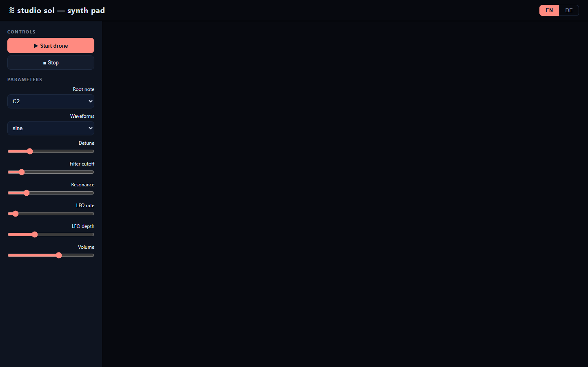
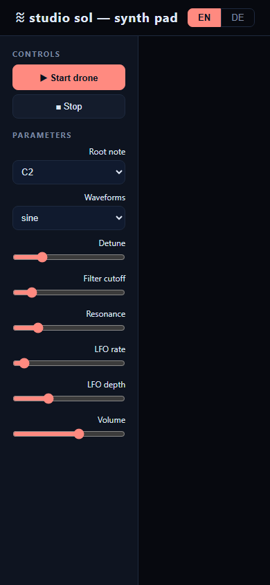

# Studio Sol — Synth Pad

A generative drone synthesizer: detuned sine + triangle oscillators through a resonant lowpass filter with LFO modulation and live spectrum visualization.

<div align="center">


**[Live Demo](https://ruslanfridenli.github.io/studio-sol-nzd28l/)** · **[Deutsch ↓](#-deutsch)**

</div>

---

## Screenshots






## Features

- Detuned dual-oscillator drone engine
- Resonant lowpass filter with LFO modulation
- Five selectable waveform types
- Live frequency spectrum visualization
- All parameters adjustable in real time
- English/German interface

## Local development

```bash
git clone https://github.com/ruslanfridenli/studio-sol-nzd28l.git
cd studio-sol-nzd28l
# open index.html in a browser, or serve statically:
npx serve .
```

No build step, no dependencies — pure static site.

---

## 🇩🇪 Deutsch

### Studio Sol — Synth-Pad

Ein generativer Drohnen-Synthesizer: verstimmte sine + triangle-Oszillatoren durch einen resonanten Tiefpassfilter mit LFO-Modulation und Live-Spektrumanzeige.

### Funktionen

- Verstimmte Dual-Oszillator-Drohne
- Resonanter Tiefpassfilter mit LFO-Modulation
- Fünf wählbare Wellenformen
- Live-Frequenzspektrum-Visualisierung
- Alle Parameter in Echtzeit regelbar
- Englische/deutsche Oberfläche

### Lokale Entwicklung

```bash
git clone https://github.com/ruslanfridenli/studio-sol-nzd28l.git
cd studio-sol-nzd28l
npx serve .
```

Reine statische Seite — kein Build-Schritt, keine Abhängigkeiten.

---

Made with care. Feedback welcome via issues.
